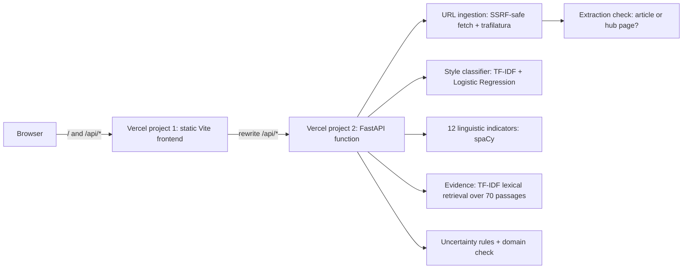

# VERITAS AI (Vercel edition) - Architecture

VERITAS AI is a statistical text-analysis instrument. It returns three separate readings (writing style, evidence relevance, trust in the analysis) and never a verdict about whether content is true. See [vercel-edition.md](vercel-edition.md) for how this edition differs from the full one.

There is no database, no authentication and no server-side storage.

## Responsibilities
| Layer | Location | Responsibility |
| --- | --- | --- |
| Frontend | `frontend/src` | Routing, forms, report rendering, one Axios instance (`services/api.js`, base `/api/v1`). Every sentence in a report is built from fields the API returned (`components/report/reportModel.js`). |
| API routes | `backend/app/api/v1/endpoints` | Thin HTTP handlers. |
| Schemas | `backend/app/schemas` | Pydantic request/response models. |
| Services | `backend/app/services` | `AnalysisService` (orchestration), `url_ingest`, `extraction_quality`, `health_service`, `performance_service`. |
| ML | `backend/app/ml` | `classifier`, `text_masking`, `ood` (domain check), `signals`, `lexical_retrieval` + `evidence`, `uncertainty`; offline `data` / `train` / `domain_profile` / `lexical_eval`. |
| Artefacts | `backend/ml_artifacts`, `backend/data/evidence` | The classifier files (committed, SHA-256 pinned) and the 70 reference passages. |
| Core | `backend/app/core` | Settings (no required values), request limiter, exception types. |

## Analysis request lifecycle
1. The browser validates the input (text 20 to 20,000 characters, or an http(s) URL) and calls `POST /api/v1/analysis` or `/api/v1/analysis/url`.
2. URL only: `url_ingest` fetches the page behind SSRF controls and extracts the article with trafilatura; `extraction_quality` flags menu, feed or index pages (`source.extraction_warning`), which only raises uncertainty.
3. `AnalysisService.analyze` computes the 12 indicators, the classifier probability and domain similarity, retrieves reference passages for the title and up to 8 sentences (lexical TF-IDF), and assesses uncertainty.
4. The response is returned; nothing is stored (`analysis_id` is `null`).
5. The frontend renders the readings separately, warnings first, limitations beside every result.

## Machine-learning pipeline
Offline (needs `requirements-dev.txt`): `python -m app.ml.train`, then `python -m app.ml.domain_profile`. WELFake is cleaned, de-duplicated and split 70/15/15 with a leakage check; publisher cues are masked (`text_masking.py`); a TF-IDF + Logistic Regression model is fitted with C chosen on validation; the test split is scored once. The committed artefacts in this edition are the original ones. Online, `StyleClassifier.predict` applies the same masking and returns the probability for the "unreliable" label. Limits: [dataset-and-model.md](dataset-and-model.md), [quality-evaluation.md](quality-evaluation.md).

## Evidence retrieval pipeline
`backend/data/evidence/reference_passages.json` holds 70 paraphrased passages with source links. `ml/lexical_retrieval.py` fits a character 3 to 5-gram TF-IDF vectorizer on them; `ml/evidence.py` queries it with the title and sentences and keeps each passage's best match. A passage with cosine similarity of at least 0.25 is flagged `relevant`. The system reports shared wording only: not meaning, support or contradiction ([analysis-api.md](analysis-api.md)).

## Cross-cutting rules
- Settings come from environment variables; none is required and none is secret ([deployment.md](deployment.md)).
- CORS allows only `FRONTEND_URL` (needed only if another origin calls the API directly). Middleware adds security headers and rejects request bodies over 1 MB.
- Errors use one envelope: `{"error": {"code", "message", "details"}}`.
- The API is versioned under `/api/v1`. Health: `/health/live`, `/health/ready` (always ready, `database: "not_used"`), `/health/models` (`not_loaded`, `loading`, `ready`, `unavailable`).

## Frontend routes
`/` overview and input, `/analyze`, `/casebook` and `/casebook/:id` (six recorded demonstration cases, invented inputs, re-recorded with this edition's pipeline), `/evidence` (reference collection explorer), `/performance` (method and measured limits).
