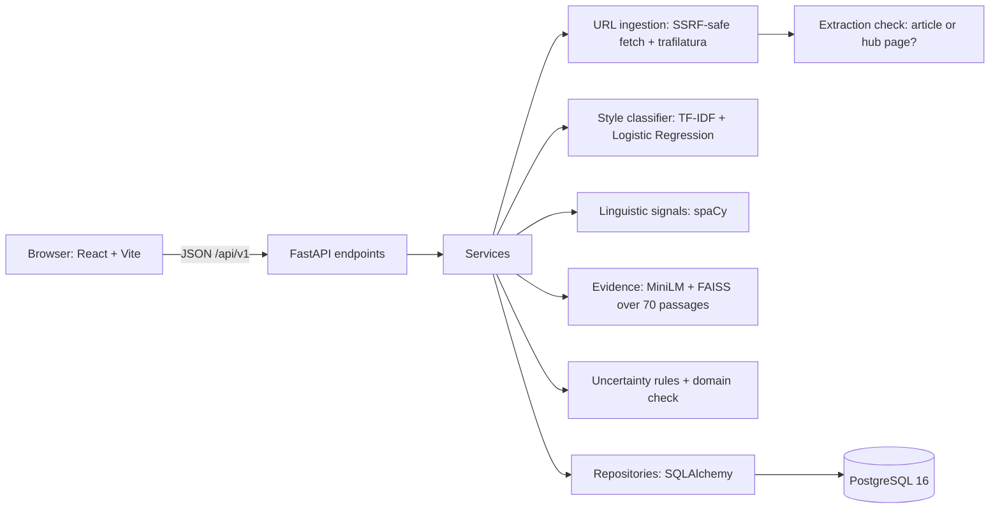

# VERITAS AI - Architecture

VERITAS AI is a statistical text-analysis instrument. It returns three separate readings (writing style, evidence relevance, trust in the analysis) and never a verdict about whether content is true.

## Responsibilities

| Layer | Location | Responsibility |
| --- | --- | --- |
| Frontend | `frontend/src` | Routing, forms, report rendering, one Axios instance (`services/api.js`). Holds no secrets; the access token lives in browser storage (`services/tokenStore.js`). Every sentence in a report is built from fields the API returned (`components/report/reportModel.js`). |
| API routes | `backend/app/api/v1/endpoints` | Thin HTTP handlers: parse input, call a service, shape the response. |
| Schemas | `backend/app/schemas` | Pydantic request/response models and validation. |
| Services | `backend/app/services` | Business logic: `AnalysisService` (orchestration), `url_ingest`, `extraction_quality`, `history_service`, `auth_service`, `health_service`, `performance_service`. Routes never touch the database directly. |
| ML | `backend/app/ml` | `classifier`, `ood` (domain check), `signals`, `retrieval` + `evidence`, `uncertainty`, and the offline `data` / `train` / `domain_profile` / `retrieval_eval` scripts. |
| Repositories | `backend/app/repositories` | All SQL for users and analyses, scoped by owner. |
| Database | `backend/app/database`, `backend/alembic` | Engine and sessions; Alembic migrations (`users`, `analyses`, a token-version column). |
| Core | `backend/app/core` | Settings (Pydantic Settings), security helpers (bcrypt, JWT), throttling, exception types. |
| Database server | `docker-compose.yml` | PostgreSQL 16 with a health check and a named volume. |

## Analysis request lifecycle

1. **Input.** The browser validates length (text 20 to 20,000 characters, or an http(s) URL) and sends `POST /api/v1/analysis` or `POST /api/v1/analysis/url`. A bearer token is optional.
2. **Ingestion (URL only).** `url_ingest` fetches the page behind SSRF controls and extracts the article with trafilatura. `extraction_quality.assess_extraction` checks, from structure alone, whether the text looks like a menu, feed or index page; if so it produces `source.extraction_warning`.
3. **Analysis.** `AnalysisService.analyze` computes linguistic signals, then the classifier probability and domain similarity, then retrieves reference passages for the title and up to 8 sentences, then assesses uncertainty from the length, domain distance, model indecision, evidence coverage and any extraction warning. The warning never changes the probability.
4. **Persistence.** If a valid token was sent, the result is saved for that user and `analysis_id` is returned; anonymous results are not stored.
5. **Report.** The frontend renders the readings separately, with the warnings first and the limitations beside every result.

## Machine-learning pipeline

Offline (`python -m app.ml.train`, then `python -m app.ml.domain_profile`): WELFake is cleaned and de-duplicated, split 70/15/15 with a leakage check, publisher cues are masked, a TF-IDF + Logistic Regression model is fitted with C chosen on the validation split, the test split is scored once, and `ml_artifacts/metrics.json` is written. The domain profile stores the mean training vector and a cut-off at the 5th percentile of validation similarity. Online, `StyleClassifier.predict` applies the same masking and returns the probability for the "unreliable" label. Details and limits: [dataset-and-model.md](dataset-and-model.md), [quality-evaluation.md](quality-evaluation.md), and section 15 of [technical-report.md](technical-report.md).

## Evidence retrieval pipeline

`backend/data/evidence/reference_passages.json` holds 70 paraphrased passages with source links. `ml/retrieval.py` embeds them with MiniLM (`all-MiniLM-L6-v2`) into a FAISS index; `ml/evidence.py` embeds the article title and sentences as queries and returns the closest passages with cosine similarity. A passage with similarity of at least 0.40 is flagged `relevant`. The system reports topical relevance only, not support or contradiction ([analysis-api.md](analysis-api.md)).

## Authentication and saved analyses

JWT bearer authentication, an optional-auth analysis endpoint that saves results for signed-in users, ownership-scoped history (`/analyses`), and account deletion. See [auth.md](auth.md) and [database-schema.md](database-schema.md).

## Cross-cutting rules

- Configuration comes from environment variables or the root `.env`. `SECRET_KEY` and `DATABASE_URL` are required and stored as `SecretStr`.
- CORS allows only `FRONTEND_URL` (and its 127.0.0.1 variant). Middleware adds security headers and rejects request bodies over 1 MB.
- Errors use one envelope: `{"error": {"code", "message", "details"}}`. Unhandled errors return a generic message; stack traces stay in server logs.
- The API is versioned under `/api/v1`. Health: `/health/live` (process), `/health/ready` (database), `/health/models` (ML load state: `not_loaded`, `loading`, `ready`, `unavailable`).
- The ML components load once in a background thread at startup (`AnalysisService.preload`); a request that arrives meanwhile waits for the load.

## Frontend routes

`/` overview and input, `/analyze` workspace, `/casebook` and `/casebook/:id` six recorded demonstration cases (invented inputs), `/evidence` reference collection explorer, `/performance` method and measured limits, `/login` and `/register`, and (signed in) `/history`, `/history/:id`, `/settings`.

## Packaging

The stack runs from `docker-compose.yml` (database, backend, nginx-served frontend; see [deployment.md](deployment.md)). CI ([`.github/workflows/ci.yml`](../.github/workflows/ci.yml)) runs backend tests with bandit, frontend lint, tests, build and audit, and the image build.
